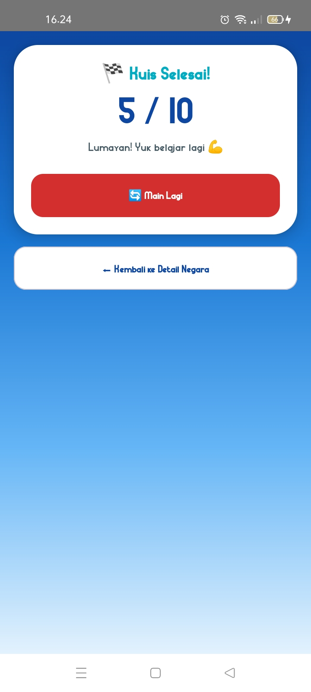
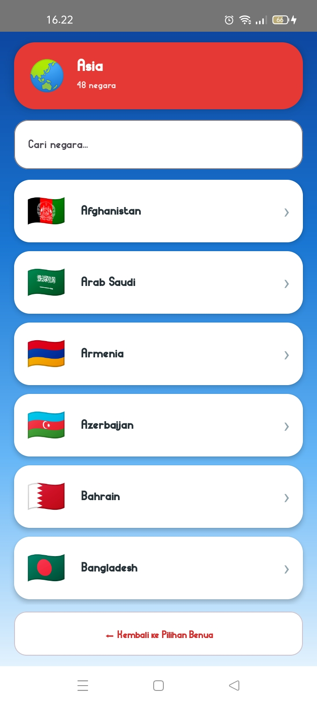
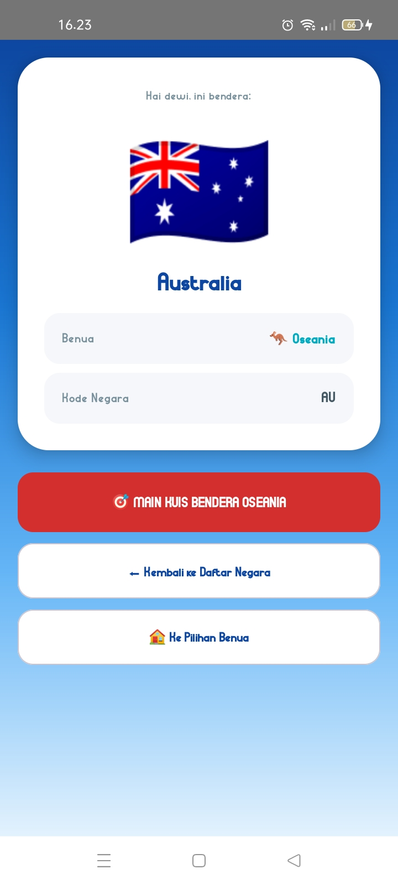
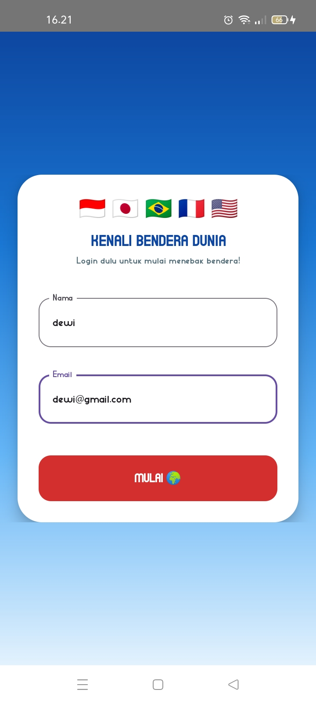
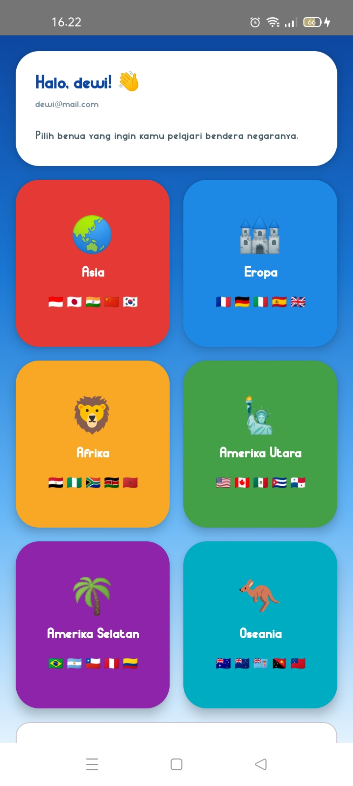

# Benderaku (Aplikasi Mobile 4-Tier)

Aplikasi **Belajar Mengenal Bendera Negara di Dunia** berbasis Android yang dikembangkan menggunakan Kotlin dan Jetpack Compose di Android Studio. Aplikasi ini dibuat untuk tugas pemrograman mobile guna mempelajari navigasi multi-layar, transfer data antar *Activity* menggunakan *Intent Extra*, serta **validasi input dinamis** pada halaman login.

## 🌍 Fitur & Layar Aplikasi (4 Activity - 5 Layar)

1. **Layar 1 (MainActivity - Login)**: Halaman pertama untuk memasukkan nama dan email sebelum mulai belajar.
2. **Layar 2 (Validasi Input / Error State)**: Tampilan validasi input secara langsung saat mengetik. Jika nama kosong atau kurang dari 2 karakter, atau email kosong atau tidak mengandung `@`, garis kolom berubah menjadi **merah** dan pesan error tampil di bawahnya.
3. **Layar 3 (SecondActivity - Pilih Benua)**: Halaman sapaan dengan nama pengguna (*Intent Extra*) dan pilihan 6 benua: Asia, Eropa, Afrika, Amerika Utara, Amerika Selatan, dan Oseania.
4. **Layar 4 (ThirdActivity - Daftar Negara)**: Daftar lengkap negara beserta benderanya sesuai benua yang dipilih, diurutkan A-Z, dilengkapi **kolom pencarian** untuk menemukan negara dengan cepat.
5. **Layar 5 (FourthActivity - Detail Negara & Kuis)**: Halaman detail dengan bendera berukuran besar, nama negara, benua, dan kode negara. Terdapat juga **Kuis Tebak Bendera** (10 soal pilihan ganda) dengan skor dan hasil akhir.

## 🚩 Jumlah Negara per Benua

| Benua | Jumlah Negara |
| :--- | :---: |
| Asia | 48 |
| Eropa | 45 |
| Afrika | 54 |
| Amerika Utara | 23 |
| Amerika Selatan | 12 |
| Oseania | 14 |

> Antartika tidak dimasukkan karena tidak memiliki negara.

## 🛠️ Komponen & Teknologi yang Digunakan

- **Bahasa & Framework**: Kotlin, Jetpack Compose (Material 3)
- **Komponen Utama**: Activity & Intent Data Passing (`EXTRA_NAMA`, `EXTRA_EMAIL`, `EXTRA_BENUA`, `EXTRA_NEGARA`, `EXTRA_KODE`), Validasi dengan state `isError` dan `supportingText`, `LazyVerticalGrid` dan `LazyColumn`, state management dengan `remember` dan `mutableStateOf`
- **Bendera**: Emoji bendera yang dibuat otomatis dari kode negara ISO 2 huruf (misalnya `ID` menjadi 🇮🇩), sehingga tidak membutuhkan file gambar

## 🧩 Struktur Project

```
com.example.benderaku
├── MainActivity.kt     # Login + validasi nama & email
├── SecondActivity.kt   # Pilihan benua
├── ThirdActivity.kt    # Daftar negara + pencarian + data seluruh negara
└── FourthActivity.kt   # Detail negara + kuis tebak bendera
```

## 🚀 Cara Menjalankan Aplikasi (Langsung di HP)

1. **Persiapan HP**:
   - Aktifkan **Developer Options** (Opsi Pengembang) di HP Android kamu.
   - Aktifkan fitur **USB Debugging** di dalam menu Opsi Pengembang.
   - Sambungkan HP ke laptop menggunakan kabel USB.
2. **Clone & Buka Project di Android Studio**:
   - Buka terminal/command prompt, lalu unduh repository dengan perintah:
     ```bash
     git clone https://github.com/USERNAME-KAMU/Benderaku.git
     ```
   - Buka folder hasil *clone* tersebut melalui Android Studio.
   - Tunggu proses *Gradle Sync* sampai selesai.
3. **Jalankan Aplikasi**:
   - Di bagian atas Android Studio, pastikan perangkat yang dipilih adalah nama HP fisikmu (bukan emulator).
   - Klik tombol **Run (ikon play hijau / Shift + F10)** untuk *build* dan *install* aplikasi secara otomatis langsung ke HP-mu.

## 📸 Tangkapan Layar (Screenshot)

| Layar 1 (Login) | Layar 2 (Invalid Input) | Layar 3 (Pilih Benua) | Layar 4 (Daftar Negara) | Layar 5 (Detail & Kuis) |
| :---: | :---: | :---: | :---: | :---: |
|  |  |  |  |  |

## 🎥 Demo Aplikasi

Berikut adalah video demonstrasi penggunaan aplikasi:

📹 **Video Demo Aplikasi:** 👉 **[Download & Tonton Video Demo (MP4)](demo_aplikasi.mp4)**
*(Klik tautan di atas atau pilih file `demo_apk.mp4` di repository GitHub, lalu klik "View raw" untuk mengunduh atau memutar video demonya).*

---
*Dikembangkan untuk pembelajaran Pemrograman Mobile.*
